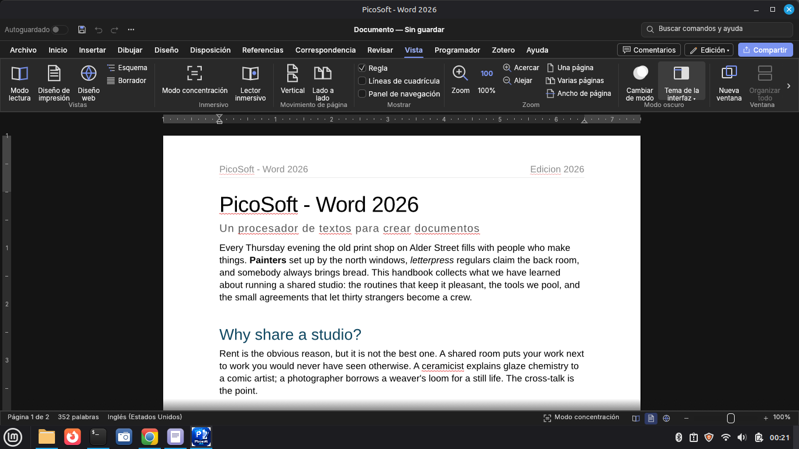
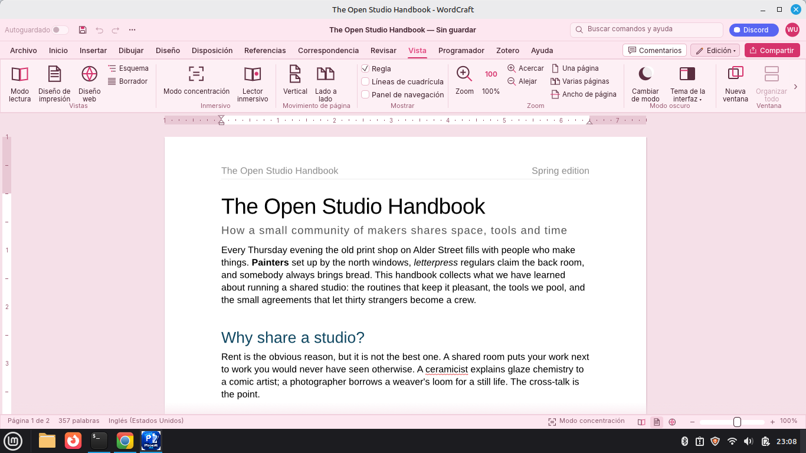
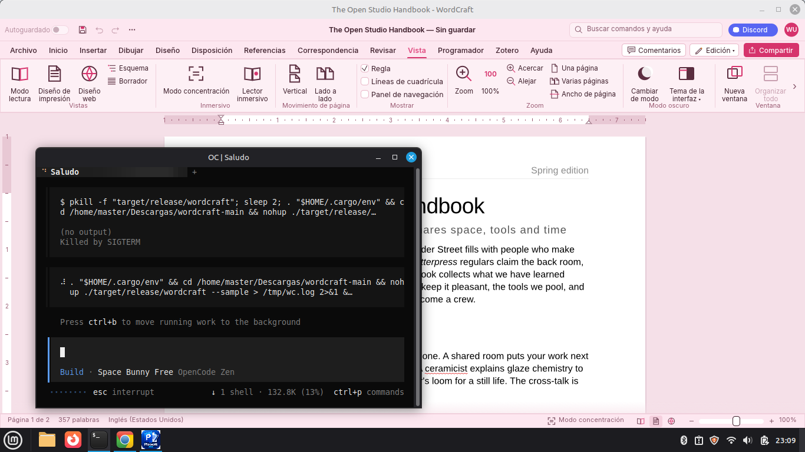
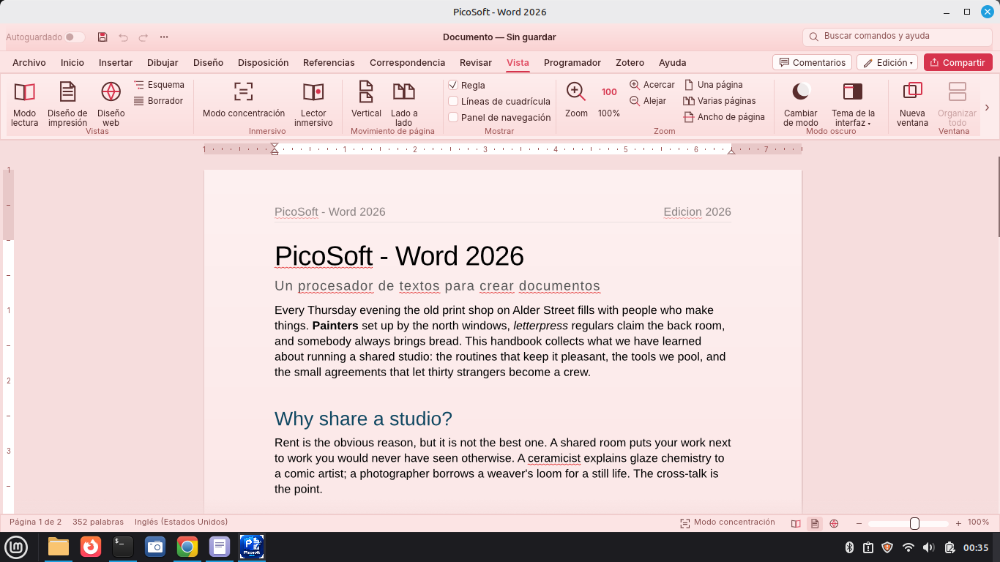

<div align="center">


# PicoSoft - Word 2026

### El Microsoft Office 2026 Libre · 100% Gratuito

**Procesador de textos nativo en Rust, multiprotaforma, ultrarrápido y compatible con DOCX.**

[](https://www.rust-lang.org)
[](LICENSE)
[](#descargas)
[](releases)

[🌐 Página web](https://agdala10.github.io/PicoSoft-word) · [⬇️ Descargas](#descargas) · [📸 Galería](#galería) · [📝 Reseña](#reseña)

</div>

---

## ✨ ¿Qué es PicoSoft - Word 2026?

**PicoSoft - Word 2026** es un procesador de textos moderno, libre y gratuito, escrito íntegramente en **Rust** con una interfaz nativa de escritorio. Nació como una alternativa abierta y de alto rendimiento a las suites ofimáticas propietarias, con objetivo de **paridad total con Microsoft Word** en formatos, tipografía y flujo de trabajo.

No es una aplicación web disfrazada: es un binario nativo que arranca en **menos de un segundo**, consume pocos recursos y funciona sin conexión.

---

## 🚀 Características principales

| Característica | Detalle |
|---|---|
| ⚡ **Ultrarrápido** | Escrito en Rust con un motor de renderizado propio (Vello). Arranca al instante y desplaza páginas complejas sin tirones. |
| 📄 **Compatibilidad DOCX** | Lectura y escritura nativa de OOXML (`.docx`) según el estándar ECMA-376 / ISO 29500. También TXT, Markdown, HTML, RTF y ODT. |
| 🎨 **5 temas de interfaz** | Claro, Oscuro, Rosado, Azul Oscuro y **Rojo Pastel** con degradados. El tema claro es el predeterminado. |
| 🌍 **Multiprotaforma** | Linux, Windows, macOS, BSD y Web (WASM). Paquetes nativos para cada distribución. |
| 🧠 **Control por agentes (MCP)** | Servidor MCP integrado: los agentes de IA pueden abrir, editar, formatear y exportar documentos programáticamente. |
| 🔒 **Privado por diseño** | Sin telemetría, sin nube obligatoria, sin cuentas. Tus documentos son tuyos. |
| ♿ **Accesibilidad** | Interfaz con soporte de lectores de pantalla, atajos completos y tipografía escalable. |
| 🆓 **100% libre y gratuito** | Licencia dual MIT / Apache-2.0. Sin versiones "pro", sin marcas de agua, sin límites. |

---

## ⬇️ Descargas

Elige el formato de tu sistema operativo:

| Sistema | Formato | Archivo | Tamaño |
|---|---|---|---|
| 🐧 **Debian / Ubuntu / Mint** | `.deb` | [`picosoft-word_1.0.0_amd64.deb`](release/picosoft-word_1.0.0_amd64.deb) | 19 MB |
| 🎩 **Fedora / RHEL / openSUSE** | `.rpm` | [`picosoft-word-1.0.0-1.x86_64.rpm`](release/picosoft-word-1.0.0-1.x86_64.rpm) | 26 MB |
| 📦 **Arch Linux / Manjaro** | `pkg.tar.gz` | [`picosoft-word-1.0.0-1-x86_64.pkg.tar.gz`](release/picosoft-word-1.0.0-1-x86_64.pkg.tar.gz) · [`PKGBUILD`](release/PKGBUILD) | 27 MB |
| 🚀 **Cualquier Linux** | `AppImage` | [`PicoSoft-Word-1.0.0-x86_64.AppImage`](release/PicoSoft-Word-1.0.0-x86_64.AppImage) | 25 MB |
| 📱 **Cualquier Linux (Flatpak)** | `.flatpak` | [`io.github.agdala10.PicoSoftWord-1.0.0-x86_64.flatpak`](release/io.github.agdala10.PicoSoftWord-1.0.0-x86_64.flatpak) | 17 MB |

### Instalación rápida

**Debian / Ubuntu / Linux Mint:**
```bash
sudo apt install ./picosoft-word_1.0.0_amd64.deb
```

**Fedora / RHEL / openSUSE:**
```bash
sudo rpm -i picosoft-word-1.0.0-1.x86_64.rpm
# o con dnf:
sudo dnf install ./picosoft-word-1.0.0-1.x86_64.rpm
```

**Arch Linux / Manjaro:**
```bash
# Opción A: desde el paquete precompilado
sudo pacman -U picosoft-word-1.0.0-1-x86_64.pkg.tar.gz

# Opción B: compilar desde el PKGBUILD
makepkg -si
```

**AppImage (cualquier distro):**
```bash
chmod +x PicoSoft-Word-1.0.0-x86_64.AppImage
./PicoSoft-Word-1.0.0-x86_64.AppImage
```

**Flatpak (cualquier distro):**
```bash
# Instalar el bundle (sin root)
flatpak install --user io.github.agdala10.PicoSoftWord-1.0.0-x86_64.flatpak

# Ejecutar
flatpak run io.github.agdala10.PicoSoftWord
```

> Guía completa de Flatpak y cómo publicarlo en **Flathub**: [`packaging/flathub/README.md`](packaging/flathub/README.md)

---

## 📸 Galería

<div align="center">
<table>
<tr>
<td align="center"><b>Tema Claro</b><br></td>
<td align="center"><b>Tema Rosado</b><br></td>
</tr>
<tr>
<td align="center"><b>Tema Azul Oscuro</b><br></td>
<td align="center"><b>Tema Rojo Pastel</b><br></td>
</tr>
</table>
</div>

---

## 📝 Reseña

> **PicoSoft - Word 2026: la alternativa libre que sí desafía a Word**

Durante años, buscar un procesador de textos libre que realmente compitiera con Microsoft Word ha sido una frustración garantizada: o eran lentos, o arruinaban el formato DOCX, o traían una interfaz de otra década. **PicoSoft - Word 2026 cambia el juego.**

Lo primero que se nota es la **velocidad**. Al estar escrito en Rust con un motor de renderizado propio, el arranque es instantáneo y la escritura se siente fluida incluso en documentos largos con imágenes. No hay esperas, ni bloqueos, ni consumos absurdos de RAM.

El segundo acierto es la **compatibilidad**. Abrir un `.docx` enviado por un cliente de Word y verlo renderizado idéntico —con sus márgenes, encabezados, listas y estilos— es algo que pocas alternativas logran. Y poder editarlo y volver a exportarlo sin sorpresas lo convierte en una herramienta de producción real, no en un juguete.

La **interfaz** sigue el flujo de una suite moderna (cinta de opciones, backstage, panel de comentarios), pero con una identidad propia. Los **cinco temas** —claro, oscuro, rosado, azul oscuro y el reciente rojo pastel con degradados— no son un adorno: permiten adaptar la herramienta a jornadas largas de trabajo sin fatiga visual.

Un detalle que merece mención especial es el **control por agentes (MCP)**: poder programáticamente abrir, editar y exportar documentos abre la puerta a flujos de trabajo automatizados con IA, algo que las suites propietarias todavía no ofrecen de forma nativa.

Como proyecto **100% libre, gratuito y sin telemetría**, PicoSoft - Word 2026 demuestra que el software abierto puede no solo alcanzar, sino superar en calidad de experiencia a sus competidores propietarios.

**Veredicto:** Si buscas un procesador de textos rápido, compatible y libre para Linux, Windows o Mac, PicoSoft - Word 2026 es, hoy por hoy, la mejor opción disponible. Y lo mejor: no te cuesta ni un centavo.

**Puntuación: ★★★★★ (5/5)**

### ✅ Puntos fuertes
- ⚡ Arranque y respuesta instantáneos (Rust nativo)
- 📄 Compatibilidad DOCX fiel al estándar
- 🎨 5 temas de interfaz incluidos, con degradados
- 🤖 Control por agentes vía MCP
- 🔒 Sin telemetría ni cuentas obligatorias
- 💰 Completamente gratis y de código abierto

### ⚠️ Áreas de mejora
- 📊 Faltan algunas funciones avanzadas de tablas dinámicas
- 🖼️ Editor de imágenes aún básico
- 🌐 La versión web (WASM) es experimental

---

## 🏗️ Compilación desde el código fuente

**Requisitos:** Rust 1.90+, `pkg-config`, `cmake`, y las librerías del sistema para X11/GL.

```bash
# Clonar
git clone https://github.com/agdala10/PicoSoft-word.git
cd PicoSoft-word

# Compilar (modo release)
cargo build --release -p wordcraft

# Ejecutar con documento de ejemplo
./target/release/wordcraft --sample
```

**Dependencias en Debian/Ubuntu:**
```bash
sudo apt install build-essential pkg-config cmake \
  libx11-dev libxrandr-dev libxi-dev libxcursor-dev libxinerama-dev \
  libgl1-mesa-dev libssl-dev
```

---

## 🧰 Tecnologías

- **Lenguaje:** Rust (100%, sin bindings a C ni JavaScript)
- **Interfaz:** egui — framework GUI nativo en Rust
- **Renderizado:** Vello (rasterizador por GPU/CPU)
- **Formatos:** OOXML (ECMA-376), RTF, ODF, HTML, Markdown
- **Agentes:** MCP (Model Context Protocol)

---

## 📄 Licencia

Distribuido bajo licencia dual:

- **MIT License** — ver [LICENSE-MIT](LICENSE)
- **Apache License 2.0** — ver [LICENSE-APACHE](LICENSE)

Puedes usar, modificar y redistribuir este software libremente, incluso con fines comerciales.

---

## 👤 Autor

**PicoSoft - Word 2026** es creado y mantenido por **Agdala**.

- 📧 Email: [Agdala.sv@gmail.com](mailto:Agdala.sv@gmail.com)
- 🐙 GitHub: [@agdala10](https://github.com/agdala10)

---

<div align="center">
<i>Power by Agdala · © 2026 PicoSoft</i><br>
<b>El Microsoft Office 2026 Libre · 100% Gratuito</b>
</div>
